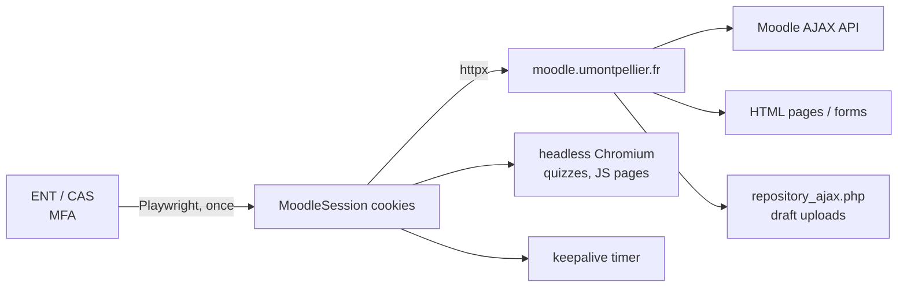

# Moodle UM — CLI + MCP server

[](https://github.com/do-2k25-28/moodle-um/actions/workflows/ci.yml)
[](https://www.python.org/)
[](LICENSE)
[](https://modelcontextprotocol.io/)

A CLI and **MCP server** for the University of Montpellier Moodle
(<https://moodle.umontpellier.fr>). It signs in through the real **ENT/CAS**
flow, then lets you or an AI agent browse courses, read and submit assignments,
download course files, check grades and deadlines, and drive pages that have no
dedicated tool.

> Independent project. Not affiliated with or endorsed by Université de
> Montpellier. Use it responsibly — see [Responsible use](#responsible-use).

## First run — sign in once

Requirements: Python ≥ 3.12, [uv](https://docs.astral.sh/uv/), and Chromium or
Google Chrome.

**The only manual step is the first ENT login.** Clone, install, and sign in
once:

```bash
git clone https://github.com/do-2k25-28/moodle-um.git
cd moodle-um
uv sync
uv run moodle-um login
uv run moodle-um status
```

A Chromium window opens on the ENT/CAS page. Sign in with your identifiant and
MFA; the window closes automatically when the Moodle session is detected. The
session is saved in `~/.config/moodle-um/` (mode `0600`) and reused by every CLI
command and MCP tool.

- **No password is stored** — only the resulting session cookies.
- **MCP:** if `moodle_status` returns `authenticated: false`, call
  `moodle_login` once before any other tool. The server does not open a browser
  by itself.
- **Expired session:** run `moodle-um login` again, or keep it alive with the
  [keepalive timer](#keep-the-session-alive).
- You do **not** sign in per command, per course, or per tool call.

Optional: `uv tool install .` puts `moodle-um` and `moodle-um-mcp` on your
`PATH`.

## What it can do

| Area | Capabilities |
| --- | --- |
| **Courses** | List enrolled courses, sections, activities, resources, descriptions, completion info |
| **Assignments** | List *devoirs*, due dates, submission status, instructions, attachments |
| **Submission** | Upload files and/or online text, accept the originality statement, final submit, remove a submission |
| **Files** | Download `pluginfile.php` resources, assignment attachments, course documents |
| **Grades** | Read the per-course grade report |
| **Calendar** | Upcoming deadlines and action events |
| **Quizzes** | List quizzes, read settings/attempts/grades, **start/resume an attempt, read questions + choices, save answers and submit with confirmation**; finished attempts are parsed from the review page |
| **Any page** | Fetch any Moodle page as Markdown, or drive it with a headless browser (`click`, `fill`, `select`, `check`, `set_file`, `goto`) |
| **Interfaces** | Typer CLI + stdio MCP server (Claude Desktop, Claude Code, Cursor, DeepSeek Harness, any MCP client) |
| **Session** | One interactive ENT login, saved cookies, optional keepalive timer |

## What it cannot do (yet)

| Limitation | Detail |
| --- | --- |
| **No SEB / proctoring bypass** | Safe Exam Browser, lockdown browsers and proctoring are not bypassed. If an exam requires SEB, use SEB. |
| **No built-in LLM solver** | The MCP exposes the questions and a save/submit API; the calling AI proposes the answers. You review them before submission. |
| **No SEB / proctoring bypass** | Safe Exam Browser, lockdown browsers and proctoring are not bypassed. If an exam requires SEB, use SEB. |
| **No teacher/admin actions** | The tool acts as the logged-in student. |
| **Not every activity type** | BigBlueButton, H5P, attendance, etc. are reachable through the generic page/browser tools, not first-class tools. |
| **MFA is interactive** | No password is stored, so the first login needs a browser and MFA. |
| **Session lifetime** | Moodle expires idle sessions after ~2 h. The keepalive timer prevents this while the machine is awake; a long suspend can still require a new login. |

## CLI

```bash
uv run moodle-um courses                  # all enrolled courses
uv run moodle-um courses -q ansible       # filter
uv run moodle-um course <course-id>       # sections + activities
uv run moodle-um assignments <course-id>  # devoirs, due dates, status
uv run moodle-um assignment <cmid>        # one devoir in detail
uv run moodle-um upcoming -n 20           # deadlines / calendar
uv run moodle-um grades <course-id>       # grade report
uv run moodle-um quizzes <course-id>
uv run moodle-um quiz <cmid>
uv run moodle-um quiz-start <cmid>          # start/resume, get questions + choices
uv run moodle-um quiz-attempt <attempt-id>  # read a page of an attempt
uv run moodle-um quiz-solve <attempt-id> --answers '{"1":"b","2":"Paris"}'
uv run moodle-um quiz-submit <attempt-id> --yes
```

Read any page as Markdown:

```bash
uv run moodle-um page '/mod/forum/view.php?id=<id>'
uv run moodle-um page '/course/view.php?id=<course-id>'
```

Download a file:

```bash
uv run moodle-um download 'https://moodle.umontpellier.fr/pluginfile.php/...'
# -> ~/Downloads/moodle-um/<filename>
```

### Submit a devoir

```bash
uv run moodle-um submit <cmid> \
  --file ~/Documents/rapport.pdf \
  --text "Quelques remarques…" \
  --yes

# Undo an accidental submission:
uv run moodle-um unsubmit <cmid> --yes
```

- `--file` can be repeated.
- `--no-submit` stops after saving. **Careful:** some assignments do not use
  drafts, so saving is already a final submission. The command reports
  `submitted_for_grading` and adds a warning in that case.
- `--yes` is mandatory: the action may be graded and cannot be undone.
- If the assignment shows an originality statement ("Ce document est le fruit
  de mon propre travail…"), the tool accepts it when submitting.

The MCP equivalent is `moodle_submit_assignment` and also requires
`confirm=true`.

### Drive a page with the headless browser

For quizzes or any JS-heavy page:

```bash
uv run moodle-um browse '/mod/quiz/view.php?id=<cmid>' \
  --actions '[{"type":"click","selector":"a[href*=\"startattempt.php\"]"}]'
```

It returns the page text, URL, and every visible form element (name, label,
options). Use a second call with the returned attempt URL to fill answers and
click **Next page** / **Finish attempt**.

Supported actions: `click`, `fill`, `type`, `select`, `check`, `uncheck`,
`press`, `set_file`, `goto`, `wait`, `wait_for`, `scroll`.

## MCP server

The server uses **stdio**. Point your MCP client at the installed binary, or
run it through `uv`:

```json
{
  "mcpServers": {
    "moodle-um": {
      "command": "/absolute/path/to/moodle-um/.venv/bin/moodle-um-mcp"
    }
  }
}
```

```json
{
  "mcpServers": {
    "moodle-um": {
      "command": "uv",
      "args": ["--directory", "/absolute/path/to/moodle-um", "run", "moodle-um-mcp"]
    }
  }
}
```

### Claude.ai / cloud clients (multi-user HTTP)

claude.ai connectors need a **public HTTPS MCP URL**; they cannot spawn a local
stdio process. The server can host **one Moodle session per person**, with a
personal bearer token per user.

Run it in Streamable HTTP mode:

```bash
# 32-byte onboarding secret; do not commit or share it
SECRET=$(python3 -c 'import secrets; print(secrets.token_urlsafe(32))')
export MOODLE_UM_MULTIUSER=1
export MOODLE_UM_MCP_PATH="/$SECRET/mcp"
export MOODLE_UM_PUBLIC_URL="https://<machine>.<tailnet>.ts.net/$SECRET"
uv run moodle-um mcp --http --host 127.0.0.1 --port 8765 --path "$MOODLE_UM_MCP_PATH"
```

With Tailscale:

```bash
tailscale funnel --bg 8765
```

Each user:

1. signs in once on their own machine:
   ```bash
   uv run moodle-um login
   ```
2. opens the onboarding page and uploads
   `~/.config/moodle-um/storage_state.json`:
   ```text
   https://<machine>.<tailnet>.ts.net/<secret>/connect
   ```
3. receives a personal token, then in Claude adds the connector with:
   - **Authentication:** No sign-in
   - **Request headers:** `Authorization: Bearer <token>`
   - **MCP server URL:** `https://<machine>.<tailnet>.ts.net/<secret>/mcp`

The server validates the uploaded session against Moodle, stores it under
`~/.config/moodle-um/users/<hash>/` (mode `0600`), and routes every MCP request
to the user selected by the token. Run the keepalive for everyone with:

```bash
uv run moodle-um keepalive --all
```

A systemd user service is provided in
[`systemd/moodle-um-mcp-http.service`](systemd/moodle-um-mcp-http.service); put
deployment values in `~/.config/moodle-um/mcp.env`:

```ini
MOODLE_UM_MCP_PATH=/<secret>/mcp
MOODLE_UM_PUBLIC_URL=https://<machine>.<tailnet>.ts.net/<secret>
```

**Why not Claude OAuth?** Claude's "Sign in" authenticates the connector, but
Moodle's session cookie is scoped to `moodle.umontpellier.fr`; an OAuth login
does not give the server that cookie. The upload/token flow is the bridge that
actually links each user's Moodle account. No ENT password is stored.

**Security:** a token is a bearer credential for one Moodle session. Use HTTPS,
do not paste it into issues or screenshots, and rotate it by uploading a new
session (which creates a new token) if it leaks.

### Claude Desktop

Merge the JSON above into
`~/.config/Claude/claude_desktop_config.json` (Linux) or
`~/Library/Application Support/Claude/claude_desktop_config.json` (macOS), then
restart Claude Desktop.

### Claude Code

```bash
claude mcp add moodle-um -- /absolute/path/to/moodle-um/.venv/bin/moodle-um-mcp
```

### Cursor

Put the same `mcpServers` object in `.cursor/mcp.json` (project) or
`~/.cursor/mcp.json` (global). See [`examples/`](examples/).

### DeepSeek Harness

A config-only bundle is included in [`dsh-bundle/`](dsh-bundle/). Edit its
`cordis.patch.yml` to replace `/path/to/moodle-um`, then:

```bash
# from a terminal:
dsh plugin --profile web add file:$PWD/dsh-bundle

# or from the DSH plugin-manager tool:
plugin_manager install_bundle target=file:$PWD/dsh-bundle
```

Tools appear as `mcp__um__moodle_*` (the server name is `um`). Remove with
`plugin_manager remove_bundle target=@local/dsh-moodle-um`.

### Tools exposed

| Tool | What it does |
| --- | --- |
| `moodle_status` | Check the saved session and who is logged in |
| `moodle_login` | Open the ENT login window (interactive, once) |
| `moodle_list_courses` | Enrolled courses, with ids |
| `moodle_get_course` | Sections, activities, descriptions, file links |
| `moodle_list_assignments` | Devoirs + due dates + submission status |
| `moodle_get_assignment` | Instructions, attachments, status, edit/remove URLs |
| `moodle_submit_assignment` | Upload files / online text; final submit (`confirm=true`) |
| `moodle_remove_submission` | Undo an accidental submission (`confirm=true`) |
| `moodle_list_quizzes` | Quizzes in a course |
| `moodle_get_quiz` | Quiz settings, attempts, `start_url` |
| `moodle_quiz_start` | Start/resume an attempt; return questions, choices, input names |
| `moodle_quiz_attempt` | Read one page of an in-progress or finished attempt |
| `moodle_quiz_solve` | Save answers from question numbers/labels (does not submit) |
| `moodle_quiz_submit` | Final submit, `confirm=true` required |
| `moodle_get_grades` | Grade report for a course |
| `moodle_upcoming` | Upcoming deadlines/calendar |
| `moodle_get_page` | Any Moodle page as Markdown |
| `moodle_browser` | Headless browser + click/fill actions |
| `moodle_download_file` | Download a file to `~/Downloads/moodle-um/` |

Typical agent flow:

1. `moodle_list_courses` → pick a course id.
2. `moodle_get_course` / `moodle_list_assignments` → see what is due.
3. `moodle_get_assignment` → read instructions and attachments.
4. Ask the user to confirm, then `moodle_submit_assignment(confirm=true, …)`.
5. For a quiz: `moodle_quiz_start` → solve/read questions → `moodle_quiz_solve` → user confirms → `moodle_quiz_submit`.

The server instructions tell the model to never submit without explicit user
confirmation and never invent answers for an exam.

## Keep the session alive

Moodle expires an idle session after **2 hours**. A lightweight ping slides the
expiry forward:

```bash
uv run moodle-um keepalive --once
```

A systemd user timer can run it every 10 minutes:

```bash
mkdir -p ~/.config/systemd/user
cp systemd/moodle-um-keepalive.service systemd/moodle-um-keepalive.timer \
  ~/.config/systemd/user/
systemctl --user daemon-reload
systemctl --user enable --now moodle-um-keepalive.timer
```

Check it:

```bash
systemctl --user list-timers --all | grep moodle
journalctl --user -u moodle-um-keepalive.service -n 20
tail -f ~/.config/moodle-um/keepalive.log
```

The units use `%h/moodle-um`; adjust them if you cloned elsewhere. This keeps
the session alive while the machine is running and the timer fires. A suspend
longer than two hours can still expire it — run `moodle-um login` after waking.
Fully unattended re-login would require storing ENT credentials and an MFA
secret, which this tool deliberately does not do.

## How it works



- Login is done once in a real browser; session state is stored in
  `~/.config/moodle-um/storage_state.json`.
- Course/assignment data comes from the same HTML and AJAX endpoints the web
  interface uses, so it reflects what you see.
- File submission uploads to Moodle's draft area, then posts the normal
  submission form (including the originality statement when present).
- The generic browser layer handles JS-heavy pages without pretending every
  Moodle activity has a stable API.

## Process model — no server to host

`moodle-um-mcp` is a **stdio MCP server**, not an HTTP service:

```
AI client (Claude / Cursor / DSH)
        │  JSON-RPC over stdin/stdout
        ▼
  moodle-um-mcp  ──HTTPS──►  moodle.umontpellier.fr
```

- The AI client spawns `moodle-um-mcp` as a child process and talks to it over
  stdin/stdout. There is **no port to expose, no daemon to deploy, and nothing
  to host**.
- The process lives only while the client keeps it open. In this DeepSeek
  Harness it is a child of the Web process; the only listening socket is the
  DSH Web UI itself on `127.0.0.1:3080`.
- The optional keepalive is a systemd **user timer** running
  `moodle-um keepalive --once` every 10 minutes. It is a one-shot local job, not
  a network server.
- Network egress is limited to the university Moodle (and CAS during login).

## Where credentials live

**No ENT password and no MFA secret are stored.** The only credential material
is the browser session created by the one-time login:

| Path | Contents | Mode |
| --- | --- | --- |
| `~/.config/moodle-um/storage_state.json` | Session cookies (`MoodleSession`, CAS `TGC`/`connect.sid`) — treat as a password | `0600` |
| `~/.config/moodle-um/config.json` | Site URL, user id/name, user agent | `0600` |
| `~/.config/moodle-um/browser_profile/` | Chromium profile used for login (cookies, cache, history) | `0700` |
| `~/.config/moodle-um/keepalive.log` | Timestamps and user id of keepalive pings | `0600` |

The repository contains none of these. The DSH bundle only passes the
`MOODLE_UM_HOME` path — no secret.

To revoke access:

```bash
systemctl --user disable --now moodle-um-keepalive.timer
rm -rf ~/.config/moodle-um
```

Then log out of Moodle/ENT in your browser. Deleting the directory logs the
tool out; it does not end a separately open browser session.

## Configuration

| Variable | Default | Meaning |
| --- | --- | --- |
| `MOODLE_UM_HOME` | `~/.config/moodle-um` | Session/config directory |
| `MOODLE_UM_DOWNLOADS` | `~/Downloads/moodle-um` | Default download directory |
| `MOODLE_UM_BROWSER` | auto-detected | Chromium/Chrome executable |
| `MOODLE_UM_LOGIN_TIMEOUT` | `300` | Seconds to wait for ENT login |
| `MOODLE_UM_SITE` | `https://moodle.umontpellier.fr` | Moodle base URL |
| `MOODLE_UM_MCP_TRANSPORT` | `stdio` | `stdio` or `http` |
| `MOODLE_UM_MCP_HOST` / `PORT` | `127.0.0.1` / `8765` | HTTP bind address |
| `MOODLE_UM_MCP_PATH` | `/mcp` | Streamable HTTP path; use a random secret for remote mode |

## Quiz attempts

v0.3 adds the full **read → solve → submit** loop:

- `moodle_quiz_start(cmid)` starts or resumes an attempt (it does not submit)
  and returns the attempt id, page, timer, question text, choices, select
  options, text fields and the exact input names. Starting can consume one of
  your allowed attempts, so only use it when you explicitly want to take the
  quiz.
- `moodle_quiz_attempt(attemptid, page=0)` reads an in-progress page; if the
  attempt is finished, it parses the review page and returns the questions with
  their correct-answer markers.
- `moodle_quiz_solve(attemptid, answers, page=None)` maps answers such as
  `{"1": "b", "2": "Paris", "3": ["A", "C"]}` to the real Moodle inputs and
  saves the page. It does not submit.
- `moodle_quiz_submit(attemptid, confirm=true)` finishes the attempt. It is
  irreversible and requires explicit confirmation.
- The same actions are available from the CLI with `quiz-start`,
  `quiz-attempt`, `quiz-solve` and `quiz-submit`.

Example shape:

```json
{
  "attemptid": 42,
  "page": 0,
  "timeleft": "00:14:32",
  "questions": [
    {
      "number": 1,
      "type": "multichoice",
      "text": "What is 2 + 2?",
      "choices": [
        {"name": "q42:1_answer", "value": "0", "label": "a. 3", "selected": false},
        {"name": "q42:1_answer", "value": "1", "label": "b. 4", "selected": true}
      ]
    }
  ]
}
```

### Solving workflow

1. `moodle_quiz_start(cmid)` (or `moodle_quiz_attempt` for an in-progress
   attempt) returns the questions and choices.
2. The AI proposes answers. Show the questions and answers to the user.
3. `moodle_quiz_solve(attemptid, {"1": "b", "2": "Paris"})` saves the page.
   Repeat for each page.
4. After the user confirms, `moodle_quiz_submit(attemptid, confirm=true)`.
5. Review the result page.

The save/submit flow is tested offline against Moodle-shaped forms with a
mocked `processattempt.php`, and the parser is validated against a real finished
UM attempt. A Docker-based local Moodle lab for full end-to-end attempts is in
[docs/quiz-test-lab.md](docs/quiz-test-lab.md).

The model does the reasoning; the MCP does not embed an LLM or auto-submit a
graded exam. Do not use this on SEB/proctored exams or without the user's
explicit approval.

## Responsible use

This is a client for **your own** Moodle account. Do not use it to:

- bypass Safe Exam Browser, proctoring, or exam access rules;
- submit work that is not yours;
- access another student's data or impersonate someone else.

Submitting an assignment or an exam is final. The CLI and MCP tools require an
explicit confirmation flag; you remain responsible for what you submit. Check
your institution's rules before using automation for graded work.

## Development

```bash
uv sync
uv run pytest -q
uv run ruff check src tests
```

Layout:

```
src/moodle_um/
  auth.py        # Playwright ENT/CAS login + session persistence
  client.py      # cookie-authenticated httpx client, AJAX, downloads
  services.py    # courses, assignments, quizzes, grades, calendar, submit
  parsers.py     # HTML → text / links
  browser.py     # generic headless-browser actions
  keepalive.py   # periodic session ping
  cli.py         # Typer CLI
  mcp_server.py  # FastMCP server
tests/           # offline unit tests + local Moodle lab
systemd/         # optional keepalive timer
dsh-bundle/      # DeepSeek Harness registration
```

Debug a page's raw HTML:

```bash
uv run moodle-um raw '/mod/assign/view.php?id=<cmid>' -o /tmp/page.html
```

See [CONTRIBUTING.md](CONTRIBUTING.md) and [SECURITY.md](SECURITY.md).

## License

MIT — see [LICENSE](LICENSE).
